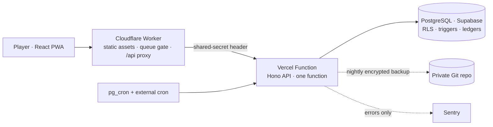

# Delphi

**A mobile game that measures how young people behave with money — built, tested and documented spec-first.**
Solo project by [hoangminhky2009-vn](https://github.com/hoangminhky2009-vn) · July–October 2026 · research prototype, not publicly launched.

<p align="center">
  
  
  
</p>
<p align="center"><sub>1 · Hub (in-browser demo: the real server runs inside a Web Worker, no backend or login needed) · 2 · Spending ledger — approved design demo with sample data; the real vault stores ciphertext only · 3 · The append-only <code>events</code> rows one real match wrote on a throwaway database. Text is in Vietnamese, the product's language.</sub></p>

<p align="center">
  
</p>
<p align="center"><sub>4 · Data structure — 15 of the 70 tables, grouped by role and generated from the migrations. Full diagram: <a href="docs/api/erd.md">docs/api/erd.md</a>.</sub></p>

## What it is

Three sources describe the same person and are compared with each other:

1. **An arena** — a turn-based investing game on a seeded, fully deterministic engine (every match can be replayed exactly; rule sets are versioned).
2. **A spending ledger** — personal-finance tracking whose contents are encrypted on the user's device (the server stores ciphertext and has no key).
3. **Self-report** — short questionnaires.

Where the three agree or disagree is the finding. The product is aimed at young adults (16–30) in Vietnam. It **describes** behaviour and never tells anyone to buy or sell an asset; tokens are play money with no cash value.

## Highlights

- **I designed the measurement, not only the app.** An append-only `events` log (enforced by PostgreSQL triggers) kept apart from a 90-day `telemetry` table with daily roll-ups, a one-line test for which row goes where, `NULL` instead of `0` when nothing was measured, and small samples shown with a flag instead of hidden or trusted. → [Measurement design](docs/measurement-design.md)
- **I measured before fixing, and kept the corrections visible.** SQL concentration analysis on production tables (8 % of accounts produced 84 % of the matches and events); a 300-match × 5-seat Monte Carlo simulation bench (22.5 % of rounds were edited by a mechanic nobody recorded); a 600-match parameter sweep that chose the pseudo-count of a small-sample smoothing constant (K0 = 4); a "found bug" that turned out to be a mis-measured note. Twelve decision records give the numbers and the mistakes, including my own. → [ADRs](docs/adr/)
- **I reviewed the system for security and proved each fix.** One high and several medium findings, fixed with an origin-bypass shared-secret gate, AES-256-GCM encrypted backups, pinned-CA TLS, `Origin` / `Sec-Fetch-Site` checks against cross-site writes, and an age gate on every entry route; each fix verified by **fault injection** (`scripts/tiem.ts`: inject, run tests, restore byte-for-byte, compare hashes) — 41 of 41 injected faults turned tests red. Auth uses argon2id, SHA-256-hashed sessions and a self-implemented TOTP checked against RFC 6238 vectors. → [SECURITY.md](SECURITY.md)
- **Integrity is enforced by the database, not only the code.** PostgreSQL triggers (append-only, zero-sum, deferred ledger-matching), `CHECK` constraints, row-level security and an ERD generated from `pg_catalog` that fails the build when it drifts. → [ERD](docs/api/erd.md)
- **Capacity was measured, not guessed.** A concurrency-ladder load test up to 800 simultaneous requests (p50 / p95 / p99 latency, pooler connection limits, `EMAXCONN` handled as `503` + jittered `Retry-After`) found the real ceiling — function memory, not database connections — and the document keeps its own earlier wrong estimate visible. → [Infrastructure limits](docs/gioi-han-ha-tang.md)

> **Status — research prototype, not publicly launched.**
> This repository makes no claim about user numbers or scale, and treats that restraint as a rule, not a courtesy: see [ADR-004](docs/adr/ADR-004-a-mapping-the-schema-does-not-state-is-a-hypothesis.md).

## Facts you can check

| | | where it comes from |
|---|---|---|
| 7,994 tests in 569 files: 4,343 server and integration tests (318 files) and 3,651 frontend tests (251 files) | tests | `npm test` and `npm --prefix web test` — integration tests run against a real embedded PostgreSQL, no database mocks. Full runs pass apart from one intermittent, seed-dependent minigame test per run, listed under [known debt](docs/architecture.md#known-debt) |
| 70 tables · 81 foreign keys · 30 integrity triggers · row-level security on every table | database | [`docs/api/erd.md`](docs/api/erd.md) is **generated** from the migrations by `npm run erd:ghi`; a test fails if it drifts |
| 148 HTTP routes, with their middleware | API | [`docs/api/danh-sach-route.md`](docs/api/danh-sach-route.md) is generated from the running app (`npm run route:ghi`); a test fails if it drifts |
| ~200k lines of TypeScript / CSS / SQL and ~126k lines of tests | size | counted over `server/`, `web/`, `config/`, `migrations/`, `scripts/`, `tests/` |
| Every security fix was verified by **injecting the fault back** and watching the test go red | process | [SECURITY.md](SECURITY.md), [ADR-011](docs/adr/ADR-011-acceptance-means-breaking-the-code-on-purpose.md), `scripts/tiem.ts` |
| $0 / month infrastructure (Cloudflare Workers + Vercel Hobby + Supabase free tier) — a constraint that holds only until there is revenue, because Vercel Hobby forbids commercial use ([ADR-008](docs/adr/ADR-008-a-ladder-of-measurable-triggers.md)) | cost | [`docs/gioi-han-ha-tang.md`](docs/gioi-han-ha-tang.md) lists every ceiling, the order they break in, and the load tests (up to 800 concurrent requests) that found them |

---

## Read it by role

| If you care about… | Read, in this order |
|---|---|
| **Data and measurement** | [Measurement design](docs/measurement-design.md) → [ADR-001](docs/adr/ADR-001-measure-before-you-fix.md) · [002](docs/adr/ADR-002-flag-the-rounds-the-crowd-edited.md) · [003](docs/adr/ADR-003-exclude-the-testers-from-the-analytics.md) · [005](docs/adr/ADR-005-a-rating-ladder-must-be-climbable.md) → [`docs/api/erd.md`](docs/api/erd.md) (generated schema diagrams) |
| **Product / requirements** | [`docs/spec/bao-loi-nguoi-choi.md`](docs/spec/bao-loi-nguoi-choi.md) — one complete spec: user outcome, out-of-scope, machine-checkable acceptance criteria, injected-fault plan → its tests (`tests/bao_loi_nguoi_choi.test.ts`, `web/tests/bao_loi_bang.test.tsx`) → [design documents](docs/thiet-ke-da-chot/) |
| **Engineering** | [Architecture](docs/architecture.md) → [SECURITY.md](SECURITY.md) → [Infrastructure limits](docs/gioi-han-ha-tang.md) (measured, with corrections left visible) → [ADR-007](docs/adr/ADR-007-react-to-overload-do-not-guess-a-threshold.md) · [009](docs/adr/ADR-009-invariants-live-in-the-database.md) · [010](docs/adr/ADR-010-store-inputs-not-outcomes.md) · [011](docs/adr/ADR-011-acceptance-means-breaking-the-code-on-purpose.md) |

Most prose in `docs/` outside the files above is Vietnamese (the language of the product's domain and of its test users). [`docs/README.md`](docs/README.md) gives an English line for every document.

## Architecture in one picture



Details, request path, trust boundaries and the honest list of known debt: [docs/architecture.md](docs/architecture.md).

## Run it

Prerequisites: Node.js ≥ 20. No Docker, no system PostgreSQL — a real PostgreSQL binary is pulled through npm.

```bash
npm ci && (cd web && npm ci)

npm run db:dev        # terminal 1 — embedded PostgreSQL on :5544
npm run migrate       # apply the migrations
npm run seed:dev      # sample data
npm run dev:api       # terminal 2 — API on :8787 (e-mails print to the console)
npm run web:dev       # terminal 3 — frontend on :5173

npm run typecheck     # server
npm test              # server + integration tests (embedded PostgreSQL per test file)
(cd web && npm test)  # frontend
npm run erd:ghi       # regenerate docs/api/erd.md
```

Copy `.env.example` to `.env` for anything beyond local defaults. Secrets are never committed.

## Repository map

| path | what is there |
|---|---|
| `server/` | Hono API. `app.ts` wires middleware and routes; `holdem/` is the deterministic arena engine; `pfm/` the encrypted-vault endpoints; `auth/` hashing, sessions, rate limits |
| `config/` | Single source of truth for every number the economy and the engine use. Code reads from here; documents point here instead of copying values |
| `migrations/` | Numbered SQL migrations (80+), one transaction each, shipped in the same commit as the code that needs them |
| `web/` | React PWA (`src/`), the Cloudflare Worker (`worker/`), and an in-browser demo mode that runs the real server inside a Web Worker (`src/demo/`) |
| `tests/`, `web/tests/` | Integration tests (real PostgreSQL), golden replays of real matches, and structural guards (generated docs, version registry, pool rules) |
| `scripts/` | Measurement harnesses (Monte Carlo balance gates, load tests), generators (routes, ERD), fault-injection runner, ops helpers |
| `docs/` | Specs, design decisions, generated references, and ADRs — indexed in [docs/README.md](docs/README.md) |

## How this was built

Spec-first and AI-assisted, and I would rather say so plainly than be asked.

- **What I did:** wrote the product thinking, the invariants, the economy rules and their hand-computed test vectors, the measurement design, the specs, and the decision log; chose between options when an agent presented them; and decided what counts as "done".
- **What AI coding assistants did:** most of the implementation, working in separate sessions under those constraints.
- **How I check it:** not by reading every line. By tests that must fail when the code is broken on purpose ([fault injection](docs/adr/ADR-011-acceptance-means-breaking-the-code-on-purpose.md)), by generated documents that fail when they drift, and by measuring before changing anything ([ADR-001](docs/adr/ADR-001-measure-before-you-fix.md)).

## Reading the code and its comments

- Comments are mostly Vietnamese. Identifiers mix Vietnamese domain terms with English infrastructure terms; [docs/naming.md](docs/naming.md) is the glossary and [ADR-012](docs/adr/ADR-012-keep-vietnamese-as-the-domain-language.md) explains why they were not renamed.
- `D<n>` in a comment is an entry in a private decision log (about 600 entries). The ones that explain the most are rewritten as [ADRs](docs/adr/). `A<n>` / `C<n>` are numbered project rules; the data, economy and invariant rules are published in [`docs/luat/`](docs/luat/).
- Known weaknesses are listed, not hidden: [docs/architecture.md → Known debt](docs/architecture.md#known-debt).

## License

All rights reserved — published for evaluation as a portfolio. See [LICENSE](LICENSE).
