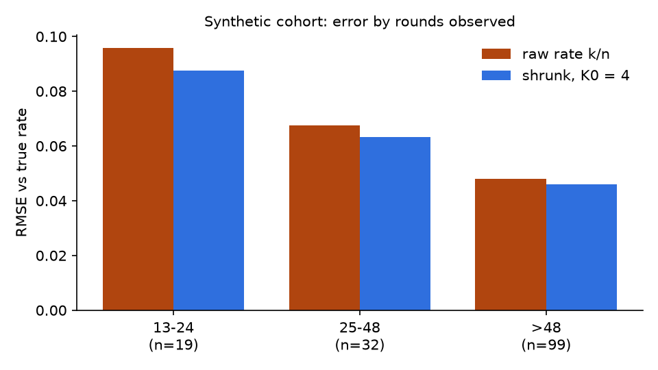
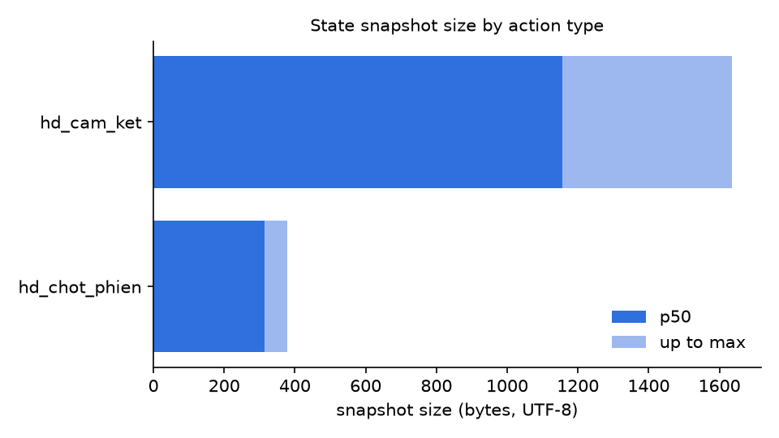

# Results (synthetic cohort)

Generated by `analyses/make_cohort.ts` and `analyses/analyze.py`.
**All numbers below come from 150 generated players. They describe the method, not users.**

Pooled cohort mean cut-loss rate: 0.240 · rounds per player: median 65, range 13-104.

## So what

- Shrinking helps most where a player has the fewest rounds: 9 % less error in the smallest group (13-24, 19 players) against 4 % in the largest (>48). Every synthetic match lasts 13 rounds, so no player has fewer than 13: the regime where shrinking matters most, a handful of rounds, is not in this cohort.
- The exact pseudo-count matters less than having one: every K0 from 2 to 8 lands within 2 % of the best error.
- None of this says anything about real players (there are none yet). It says the estimator and the queries behave as intended on data whose truth is known.

## 1. Error of a player's rate by number of rounds observed

| bin | players | rmse_raw | rmse_K0_4 | reduction_pct |
|---|---|---|---|---|
| 13-24 | 19 | 0.0958 | 0.0874 | 8.7 |
| 25-48 | 32 | 0.0674 | 0.0633 | 6.2 |
| >48 | 99 | 0.0481 | 0.0461 | 4.1 |

## 2. Choice of K0 (whole cohort)

| K0 | rmse |
|---|---|
| 0 | 0.0605 |
| 1 | 0.0588 |
| 2 | 0.0577 |
| 4 | 0.0568 |
| 8 | 0.0576 |
| 16 | 0.0629 |
| 32 | 0.0741 |

Lowest RMSE at K0 = 4, and the curve is flat between K0 = 2 and 8 (RMSE within 2 % of the minimum). The cohort's true rates were drawn from Beta(2, 6), whose ideal pseudo-count is 2 + 6 = 8, so a different draw could favour 8: one cohort of 150 players cannot separate the two. The product's K0 = 4 is a different construction (pseudo-rounds at 0.5 that fade out by round 4, ADR-005) chosen by a separate 600-match sweep on its own metric; this table neither checks nor replaces it.

The first row of table 1 rests on 19 players; read its reduction with that in mind.

## 3. Round actions in the cohort

| action | n_rounds | pct |
|---|---|---|
| dung_ngoai | 2358 | 25.9 |
| tang_cam_ket | 2331 | 25.6 |
| giu_vi_the | 2238 | 24.6 |
| cat_lo | 2186 | 24.0 |

## 4. State snapshot size by action type

| action_type | n_events | n_no_snapshot | p50_bytes | p95_bytes | max_bytes |
|---|---|---|---|---|---|
| hd_cam_ket | 9113 | 0 | 1156.0 | 1622.4 | 1635.0 |
| hd_chot_phien | 9113 | 0 | 314.0 | 372.0 | 379.0 |
| hd_chon_trait | 3505 | 3505 | NULL | NULL | NULL |
| hd_match_start | 701 | 701 | NULL | NULL | NULL |

`n_no_snapshot` counts events of that type that store no snapshot (`NULL`). They are not counted as 0 bytes.

## 5. New-account funnel (last 30 days)

| step_order | step | n | base | pct_of_base |
|---|---|---|---|---|
| 1 | account created | 94 | account created | 100.0 |
| 2 | email verified | 84 | account created | 89.4 |
| 3 | profile created | 76 | account created | 80.9 |
| 4 | research consent on | 63 | account created | 67.0 |
| 5 | tutorial finished | 43 | research consent on | 68.3 |
| 6 | entered a match | 63 | research consent on | 100.0 |
| 7 | finished 3 matches | 0 | research consent on | 0.0 |

Query: [`sql/04_funnel.sql`](../sql/04_funnel.sql) · definitions: [docs/metrics.md](../../docs/metrics.md#new-account-funnel). The drop-offs are the generator's assumptions (see `make_cohort.ts`), so this table checks the query, not a product. The last step reads 0 because no synthetic match finishes: the generator does not play the end-of-match mini-game (the limit is described at the top of `make_cohort.ts`).

## 6. Week-2 return

| split | bucket | n_signed_up | n_measurable | n_returned | return_pct | status |
|---|---|---|---|---|---|---|
| all | last 56 days | 130 | 100 | 46 | 46.0 | measured |
| signup_week | 2026-10-25 to 2026-10-31 | 15 | NULL | NULL | NULL | week 2 not over yet |
| signup_week | 2026-10-18 to 2026-10-24 | 15 | NULL | NULL | NULL | week 2 not over yet |
| signup_week | 2026-10-11 to 2026-10-17 | 8 | 8 | 2 | 25.0 | measured |
| signup_week | 2026-10-04 to 2026-10-10 | 20 | 20 | 9 | 45.0 | measured |
| signup_week | 2026-09-27 to 2026-10-03 | 23 | 23 | 12 | 52.2 | measured |
| signup_week | 2026-09-20 to 2026-09-26 | 22 | 22 | 11 | 50.0 | measured |
| signup_week | 2026-09-13 to 2026-09-19 | 18 | 18 | 8 | 44.4 | measured |
| signup_week | 2026-09-06 to 2026-09-12 | 9 | 9 | 4 | 44.4 | measured |
| age_band | 16-17 | 6 | 5 | 3 | 60.0 | measured |
| age_band | 18-22 | 76 | 59 | 27 | 45.8 | measured |
| age_band | 23-30 | 38 | 30 | 13 | 43.3 | measured |
| age_band | 31-45 | 9 | 6 | 3 | 50.0 | measured |
| age_band | 46+ | NULL | NULL | NULL | NULL | hidden: under 5 people |

Query: [`sql/05_week2_return.sql`](../sql/05_week2_return.sql) · definitions: [docs/metrics.md](../../docs/metrics.md#week-2-return). `NULL` means hidden (fewer than 5 people) or not yet measurable, never zero; the `status` column says which.
