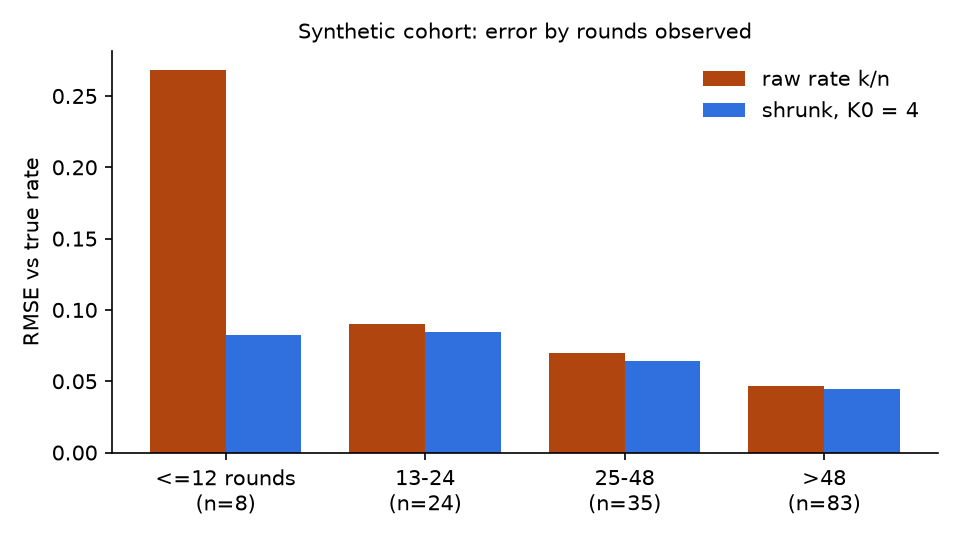
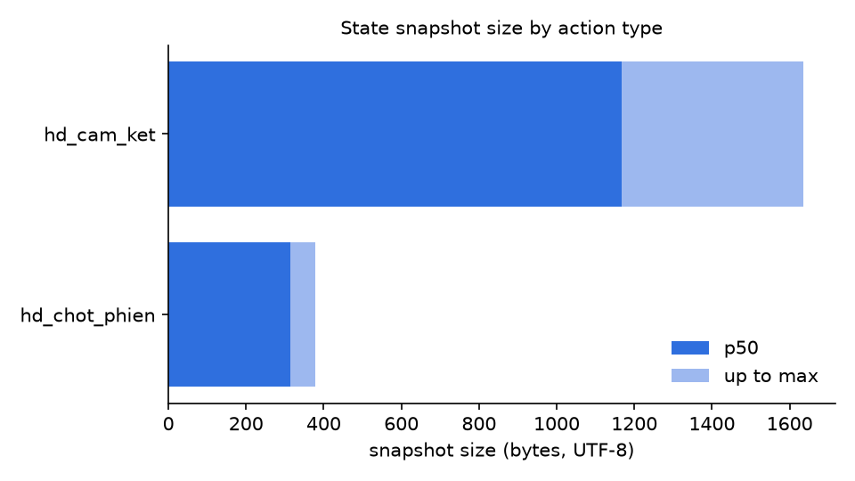

# Results (synthetic cohort)

Generated by `analyses/make_cohort.ts` and `analyses/analyze.py`.
**All numbers below come from 150 generated players. They describe the method, not users.**

Pooled cohort mean cut-loss rate: 0.223 · rounds per player: median 52, range 1-104.

## 1. Error of a player's rate by number of rounds observed

| bin | players | rmse_raw | rmse_K0_4 | reduction_pct |
|---|---|---|---|---|
| <=12 rounds | 8 | 0.2681 | 0.0821 | 69.4 |
| 13-24 | 24 | 0.0903 | 0.0844 | 6.5 |
| 25-48 | 35 | 0.0697 | 0.0642 | 7.9 |
| >48 | 83 | 0.0468 | 0.0445 | 4.7 |

## 2. Choice of K0 (whole cohort)

| K0 | rmse |
|---|---|
| 0 | 0.0865 |
| 1 | 0.0653 |
| 2 | 0.0611 |
| 4 | 0.0597 |
| 8 | 0.0615 |
| 16 | 0.0681 |
| 32 | 0.0804 |

Lowest RMSE at K0 = 4, and the curve is flat between K0 = 2 and 8 (RMSE within 3 % of the minimum). The cohort's true rates were drawn from Beta(2, 6), whose ideal pseudo-count is 2 + 6 = 8, so a different draw could favour 8: one cohort of 150 players cannot separate the two. The product's K0 = 4 came from a separate 600-match sweep on its own metric; this table does not replace that.

Note the first row of table 1: only 8 players have 12 rounds or fewer, so its large reduction rests on very few people.

## 3. Round actions in the cohort

| action | n_rounds | pct |
|---|---|---|
| dung_ngoai | 2066 | 26.7 |
| tang_cam_ket | 2040 | 26.4 |
| giu_vi_the | 1907 | 24.7 |
| cat_lo | 1722 | 22.3 |

## 4. State snapshot size by action type

| action_type | n_events | n_no_snapshot | p50_bytes | p95_bytes | max_bytes |
|---|---|---|---|---|---|
| hd_cam_ket | 7735 | 0 | 1167.0 | 1621.0 | 1635.0 |
| hd_chot_phien | 7735 | 0 | 314.0 | 372.0 | 378.0 |
| hd_chon_trait | 2940 | 2940 | NULL | NULL | NULL |
| hd_match_start | 679 | 679 | NULL | NULL | NULL |

`n_no_snapshot` counts events of that type that store no snapshot (`NULL`). They are not counted as 0 bytes.

