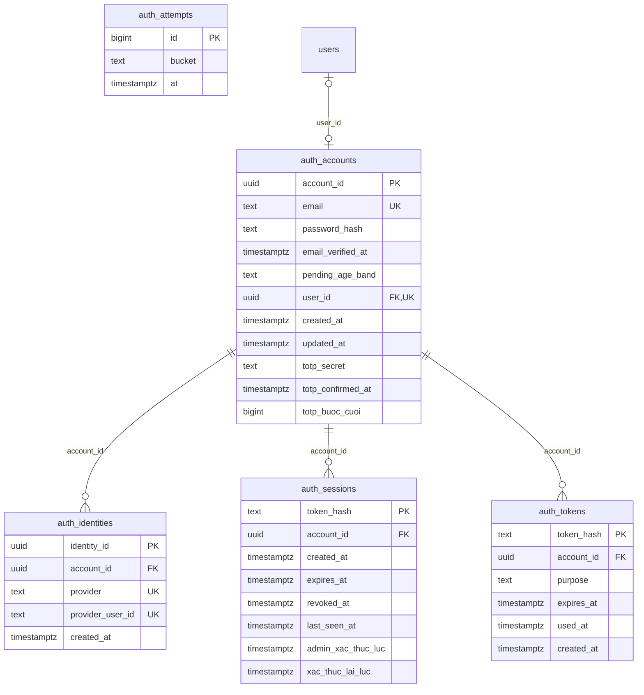
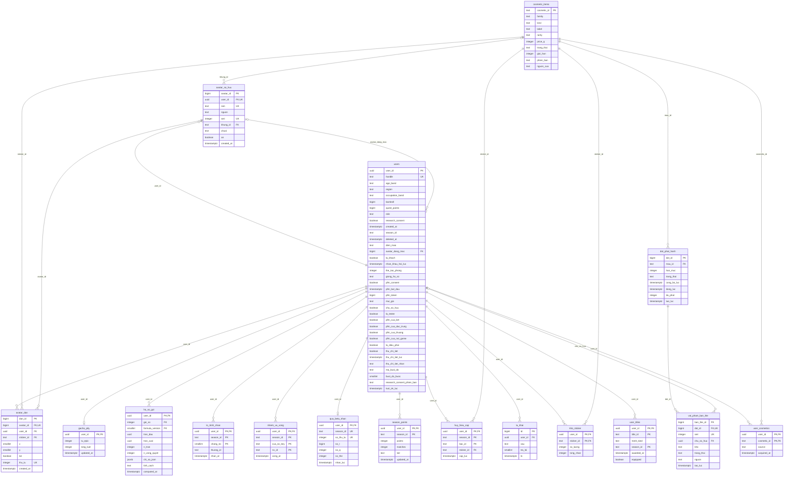
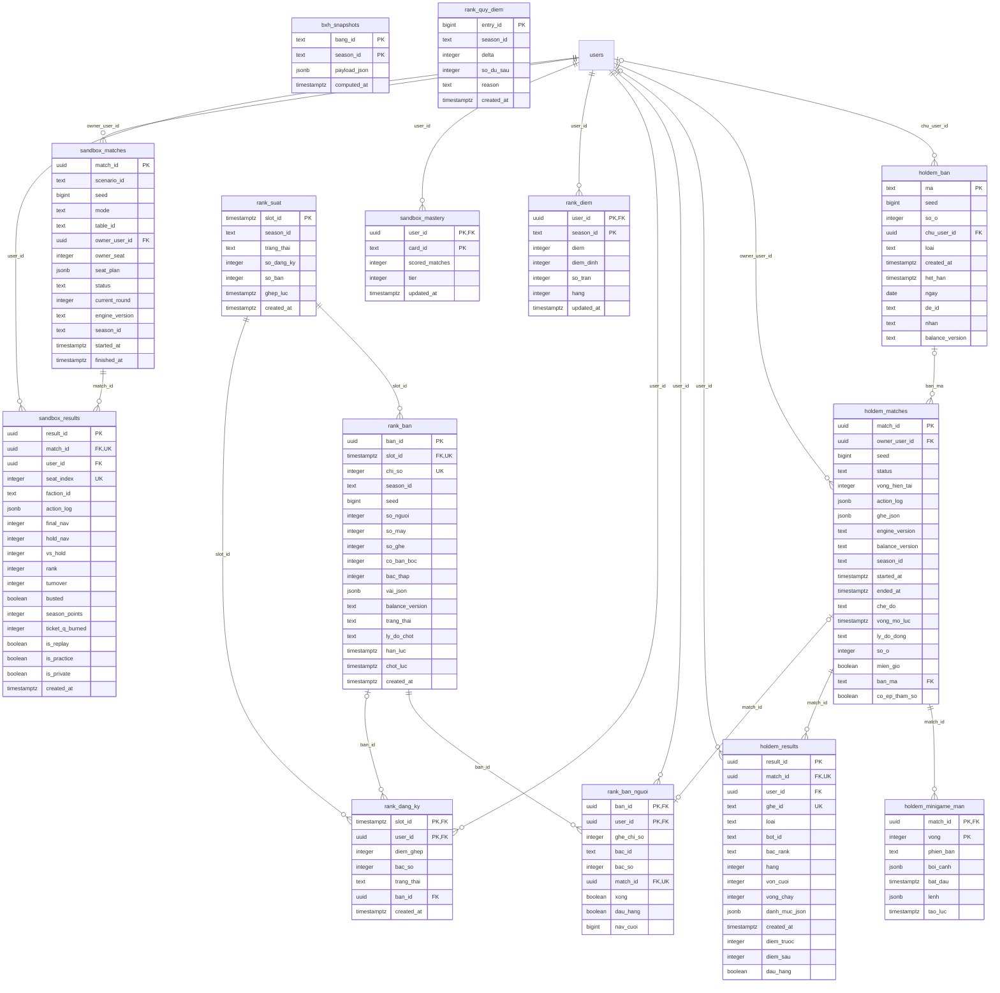
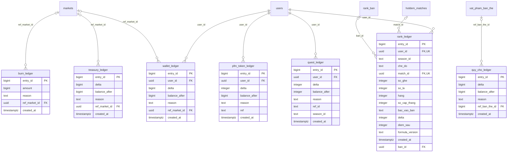
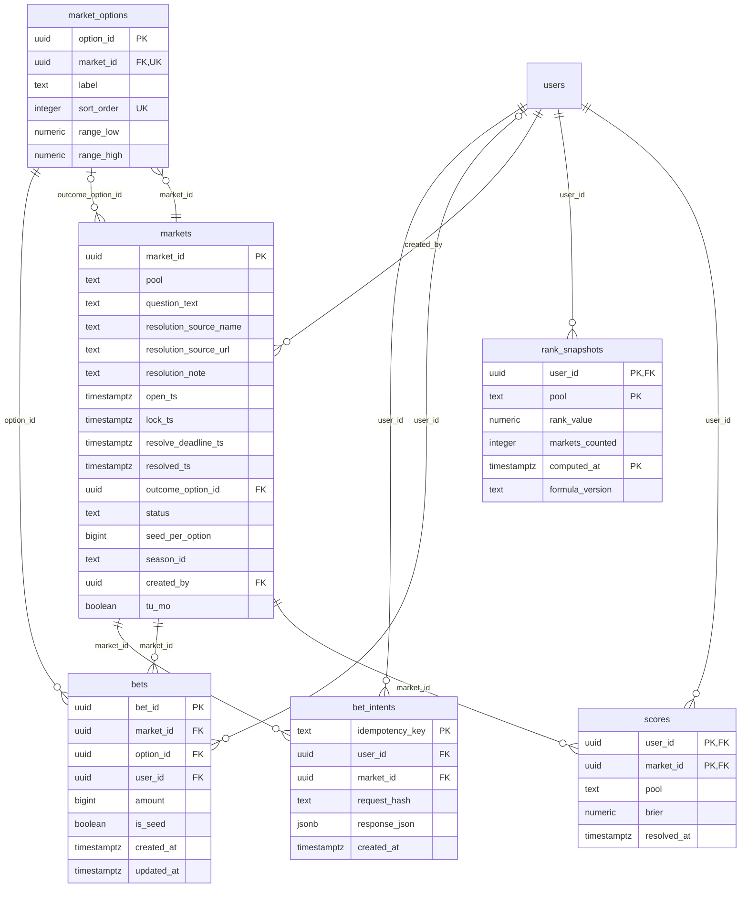
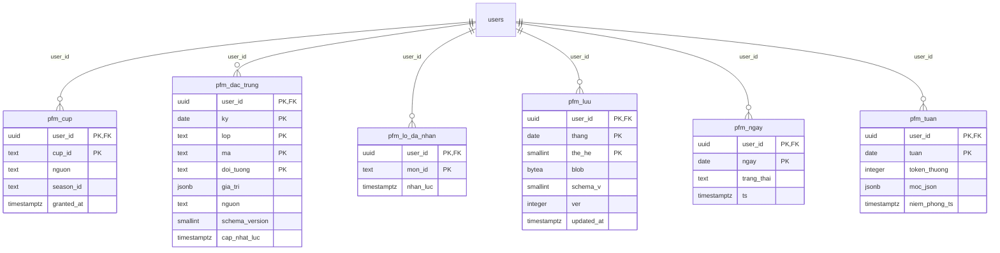
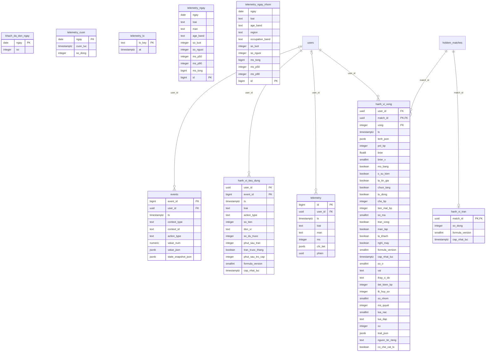
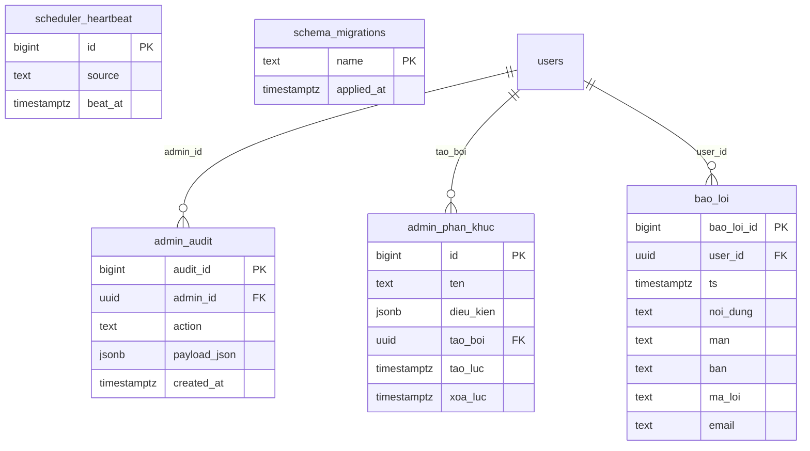

# Database schema (ERD)

<!-- Generated by `npm run erd:ghi`. Hand edits are overwritten on the next run. -->

This page is built from the migrations: `scripts/sinh_erd.ts` applies every file in `migrations/` to a
local PostgreSQL and reads the result from `pg_catalog`. If a table, column or foreign key changes and this
page is not rebuilt, `tests/erd.test.ts` fails. Tables are grouped by name prefix (exceptions in
`config/erd_mien.ts`); a relation is drawn in the group of the table that holds the foreign key.

**70** tables · **81** foreign keys · **30** triggers · row-level security on **70/70** · **0** policies · latest migration `0084_xac_nhan_tuoi.sql`.

## Checks

| check | result | test |
|---|---|---|
| foreign key without an index on its column | _none_ | `tests/khoa_ngoai_co_chi_muc.test.ts` |
| table without a primary key | _none_ | `tests/khoa_ngoai_co_chi_muc.test.ts` |

## Groups

| group | tables | FKs inside the group | FKs to other groups |
|---|---:|---:|---:|
| [Sign-in (auth)](#auth) | 5 | 3 | 1 |
| [Users & profiles](#nguoi_dung) | 17 | 23 | 0 |
| [Arena](#dau_truong) | 14 | 9 | 9 |
| [Economy — seven ledgers](#kinh_te) | 7 | 0 | 10 |
| [Prediction market (frozen)](#cho) | 6 | 6 | 5 |
| [PFM — spending ledger](#pfm) | 6 | 0 | 6 |
| [Data & telemetry](#du_lieu) | 10 | 0 | 6 |
| [Operations / admin](#van_hanh) | 5 | 0 | 3 |

## Sign-in (auth) — 5 tables

| bảng | cột | khoá ngoại → | trigger | RLS |
|---|---:|---|---|---|
| `auth_accounts` | 11 | `user_id` → `users.user_id` | — | bật · 0 policy |
| `auth_attempts` | 3 | — | — | bật · 0 policy |
| `auth_identities` | 5 | `account_id` → `auth_accounts.account_id` | — | bật · 0 policy |
| `auth_sessions` | 8 | `account_id` → `auth_accounts.account_id` | — | bật · 0 policy |
| `auth_tokens` | 6 | `account_id` → `auth_accounts.account_id` | — | bật · 0 policy |

## Users & profiles — 17 tables

| bảng | cột | khoá ngoại → | trigger | RLS |
|---|---:|---|---|---|
| `avatar_dan` | 9 | `avatar_id` → `avatar_so_huu.avatar_id` `sticker_id` → `cosmetic_items.cosmetic_id` `user_id` → `users.user_id` | `avatar_dan_append_only` `avatar_dan_no_truncate` | bật · 0 policy |
| `avatar_so_huu` | 9 | `khung_id` → `cosmetic_items.cosmetic_id` `user_id` → `users.user_id` | `avatar_so_huu_no_transfer` | bật · 0 policy |
| `cosmetic_items` | 10 | — | — | bật · 0 policy |
| `dot_phat_hanh` | 8 | `mau_id` → `cosmetic_items.cosmetic_id` | — | bật · 0 policy |
| `gacha_pity` | 4 | `user_id` → `users.user_id` | — | bật · 0 policy |
| `ho_so_goi` | 10 | `user_id` → `users.user_id` | — | bật · 0 policy |
| `huy_hieu_cap` | 5 | `sticker_id` → `cosmetic_items.cosmetic_id` `user_id` → `users.user_id` | — | bật · 0 policy |
| `kho_sticker` | 4 | `sticker_id` → `cosmetic_items.cosmetic_id` `user_id` → `users.user_id` | `kho_sticker_no_transfer` | bật · 0 policy |
| `lo_trinh_nhan` | 5 | `user_id` → `users.user_id` | — | bật · 0 policy |
| `nhiem_vu_xong` | 5 | `user_id` → `users.user_id` | — | bật · 0 policy |
| `qua_beta_nhan` | 7 | `user_id` → `users.user_id` | — | bật · 0 policy |
| `season_points` | 6 | `user_id` → `users.user_id` | — | bật · 0 policy |
| `tu_khai` | 5 | `user_id` → `users.user_id` | — | bật · 0 policy |
| `user_cosmetics` | 4 | `cosmetic_id` → `cosmetic_items.cosmetic_id` `user_id` → `users.user_id` | `user_cosmetics_no_transfer` | bật · 0 policy |
| `user_titles` | 6 | `user_id` → `users.user_id` | `user_titles_no_transfer` | bật · 0 policy |
| `users` | 36 | `avatar_dang_mac` → `avatar_so_huu.avatar_id` | `users_pfm_token_khop_so` `users_quest_points_khop_so` | bật · 0 policy |
| `vat_pham_ban_the` | 8 | `chu_so_huu` → `users.user_id` `dot_id` → `dot_phat_hanh.dot_id` | `ban_the_doi_chu` | bật · 0 policy |

## Arena — 14 tables

| bảng | cột | khoá ngoại → | trigger | RLS |
|---|---:|---|---|---|
| `bxh_snapshots` | 4 | — | — | bật · 0 policy |
| `holdem_ban` | 11 | `chu_user_id` → `users.user_id` | — | bật · 0 policy |
| `holdem_matches` | 19 | `ban_ma` → `holdem_ban.ma` `owner_user_id` → `users.user_id` | — | bật · 0 policy |
| `holdem_minigame_man` | 7 | `match_id` → `holdem_matches.match_id` | `holdem_minigame_man_chi_noi` | bật · 0 policy |
| `holdem_results` | 15 | `match_id` → `holdem_matches.match_id` `user_id` → `users.user_id` | — | bật · 0 policy |
| `rank_ban` | 17 | `slot_id` → `rank_suat.slot_id` | — | bật · 0 policy |
| `rank_ban_nguoi` | 9 | `ban_id` → `rank_ban.ban_id` `match_id` → `holdem_matches.match_id` `user_id` → `users.user_id` | — | bật · 0 policy |
| `rank_dang_ky` | 7 | `ban_id` → `rank_ban.ban_id` `slot_id` → `rank_suat.slot_id` `user_id` → `users.user_id` | — | bật · 0 policy |
| `rank_diem` | 7 | `user_id` → `users.user_id` | — | bật · 0 policy |
| `rank_quy_diem` | 6 | — | `rank_quy_diem_append_only` | bật · 0 policy |
| `rank_suat` | 7 | — | — | bật · 0 policy |
| `sandbox_mastery` | 5 | `user_id` → `users.user_id` | — | bật · 0 policy |
| `sandbox_matches` | 14 | `owner_user_id` → `users.user_id` | — | bật · 0 policy |
| `sandbox_results` | 18 | `match_id` → `sandbox_matches.match_id` `user_id` → `users.user_id` | — | bật · 0 policy |

## Economy — seven ledgers — 7 tables

| bảng | cột | khoá ngoại → | trigger | RLS |
|---|---:|---|---|---|
| `burn_ledger` | 5 | `ref_market_id` → `markets.market_id` | `burn_ledger_append_only` `burn_ledger_no_truncate` | bật · 0 policy |
| `pfm_token_ledger` | 7 | `user_id` → `users.user_id` | `pfm_token_ledger_append_only` `pfm_token_ledger_no_truncate` | bật · 0 policy |
| `quest_ledger` | 8 | `user_id` → `users.user_id` | `quest_ledger_append_only` `quest_ledger_no_truncate` | bật · 0 policy |
| `quy_cho_ledger` | 6 | `ref_ban_the_id` → `vat_pham_ban_the.ban_the_id` | `quy_cho_ledger_append_only` `quy_cho_ledger_no_truncate` | bật · 0 policy |
| `rank_ledger` | 15 | `ban_id` → `rank_ban.ban_id` `match_id` → `holdem_matches.match_id` `user_id` → `users.user_id` | `rank_ledger_append_only` `rank_ledger_no_truncate` `rank_ledger_zero_sum` | bật · 0 policy |
| `treasury_ledger` | 6 | `ref_market_id` → `markets.market_id` | `treasury_ledger_append_only` `treasury_ledger_no_truncate` | bật · 0 policy |
| `wallet_ledger` | 7 | `ref_market_id` → `markets.market_id` `user_id` → `users.user_id` | `wallet_ledger_append_only` `wallet_ledger_no_truncate` | bật · 0 policy |

## Prediction market (frozen) — 6 tables

| bảng | cột | khoá ngoại → | trigger | RLS |
|---|---:|---|---|---|
| `bet_intents` | 6 | `market_id` → `markets.market_id` `user_id` → `users.user_id` | — | bật · 0 policy |
| `bets` | 8 | `market_id` → `markets.market_id` `option_id` → `market_options.option_id` `user_id` → `users.user_id` | — | bật · 0 policy |
| `market_options` | 6 | `market_id` → `markets.market_id` | — | bật · 0 policy |
| `markets` | 16 | `created_by` → `users.user_id` `outcome_option_id` → `market_options.option_id` | — | bật · 0 policy |
| `rank_snapshots` | 6 | `user_id` → `users.user_id` | — | bật · 0 policy |
| `scores` | 5 | `market_id` → `markets.market_id` `user_id` → `users.user_id` | — | bật · 0 policy |

## PFM — spending ledger — 6 tables

| bảng | cột | khoá ngoại → | trigger | RLS |
|---|---:|---|---|---|
| `pfm_cup` | 5 | `user_id` → `users.user_id` | — | bật · 0 policy |
| `pfm_dac_trung` | 9 | `user_id` → `users.user_id` | — | bật · 0 policy |
| `pfm_lo_da_nhan` | 3 | `user_id` → `users.user_id` | — | bật · 0 policy |
| `pfm_luu` | 7 | `user_id` → `users.user_id` | — | bật · 0 policy |
| `pfm_ngay` | 4 | `user_id` → `users.user_id` | — | bật · 0 policy |
| `pfm_tuan` | 5 | `user_id` → `users.user_id` | — | bật · 0 policy |

## Data & telemetry — 10 tables

| bảng | cột | khoá ngoại → | trigger | RLS |
|---|---:|---|---|---|
| `events` | 9 | `user_id` → `users.user_id` | `events_append_only` `events_no_truncate` | bật · 0 policy |
| `hanh_vi_tieu_dung` | 13 | `user_id` → `users.user_id` | — | bật · 0 policy |
| `hanh_vi_tran` | 4 | `match_id` → `holdem_matches.match_id` | — | bật · 0 policy |
| `hanh_vi_vong` | 35 | `match_id` → `holdem_matches.match_id` `user_id` → `users.user_id` | — | bật · 0 policy |
| `khach_da_don_ngay` | 2 | — | — | bật · 0 policy |
| `telemetry` | 8 | `user_id` → `users.user_id` | — | bật · 0 policy |
| `telemetry_cuon` | 3 | — | — | bật · 0 policy |
| `telemetry_lo` | 2 | — | — | bật · 0 policy |
| `telemetry_ngay` | 10 | — | — | bật · 0 policy |
| `telemetry_ngay_nhom` | 11 | — | — | bật · 0 policy |

## Operations / admin — 5 tables

| bảng | cột | khoá ngoại → | trigger | RLS |
|---|---:|---|---|---|
| `admin_audit` | 5 | `admin_id` → `users.user_id` | `admin_audit_append_only` `admin_audit_no_truncate` | bật · 0 policy |
| `admin_phan_khuc` | 6 | `tao_boi` → `users.user_id` | — | bật · 0 policy |
| `bao_loi` | 8 | `user_id` → `users.user_id` | — | bật · 0 policy |
| `scheduler_heartbeat` | 3 | — | — | bật · 0 policy |
| `schema_migrations` | 2 | — | — | bật · 0 policy |
