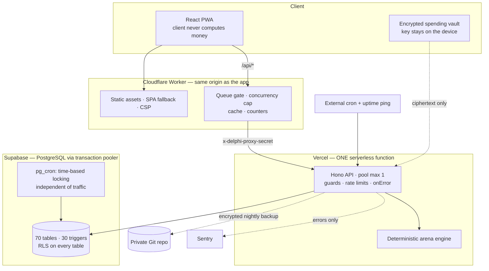

# Architecture

> English overview. The detailed specifications are in [`docs/dac-ta/`](dac-ta/) (Vietnamese; start with [`00-ban-do.md`](dac-ta/00-ban-do.md)). If a map document and the code disagree, **the code wins** — that is stated in the documents themselves.

## System

**Why this shape.** The project has a hard cost constraint ($0 until there is revenue), so each tier was chosen for its free limits and the order those limits break in was *measured* ([`gioi-han-ha-tang.md`](gioi-han-ha-tang.md), [ADR-007](adr/ADR-007-react-to-overload-do-not-guess-a-threshold.md), [ADR-008](adr/ADR-008-a-ladder-of-measurable-triggers.md)). The API is one function so that moving hosts changes exactly one file (`api/index.ts`).

## Request path, with the reason for each layer

1. **Browser → Worker.** The Worker serves the SPA and proxies `/api/*` *same-origin*, so the browser talks to one host and cookies work without CORS.
2. **Worker → API.** The Worker attaches a shared secret header on every request and strips any `x-delphi-*` / `x-dp-*` header the client sent. The API rejects `/api/*` that lack the secret with 403 *before* CORS and before any route — so a caller who finds the origin URL cannot bypass the queue gate or burn the free quota. (`/health` answers directly with two fields and no database access.)
3. **Middleware, in order** (generated, always current: [`api/danh-sach-route.md`](api/danh-sach-route.md), which also labels every route that no client calls, with the reason): proxy gate → body-size cap (reads `content-length`, never consumes the stream) → cross-origin write check (`Origin` / `Sec-Fetch-Site`) → CORS (fail-closed when unconfigured) → per-route guards: `requireAuth`, `requireOnboarded` (which also requires the age confirmation, so every business door is covered), a guest guard that closes every door to the treasury, and a three-tier admin stack (role + self-implemented TOTP + IP allow-list, with re-authentication for irreversible actions).
4. **Handler → transaction.** Everything that moves money runs inside a single transaction on the server; the client never computes a price, a payout or a cap. Writes use idempotency keys; concurrent writers use `SELECT … FOR UPDATE` or advisory locks that are transaction-scoped, because the pooler multiplexes sessions.
5. **Database.** Triggers refuse what the application must never do ([ADR-009](adr/ADR-009-invariants-live-in-the-database.md)).

## Data model

Generated from the migrations and checked in CI: [`api/erd.md`](api/erd.md) — eight diagrams by domain (accounts · arena · ranking · seven append-only ledgers · cosmetics · encrypted spending vault · events and telemetry · a frozen prediction-market module), with the foreign keys, triggers and RLS state per table.

Two rules shape most of it ([`luat/04-du-lieu.md`](luat/04-du-lieu.md)): the append-only **`events`** table holds behaviour that carries money or belief; **`telemetry`** holds interface operation, expires after 90 days and rolls up into daily aggregates. See [measurement-design.md](measurement-design.md).

## Trust boundaries

| boundary | what crosses | control |
|---|---|---|
| Internet → Worker | any request | queue gate, same-origin proxy, CSP, no `X-Frame-Options` (it would break the Discord iframe; embedding is governed by `frame-ancestors`) |
| Worker → API | proxied request + secret | secret header; client-supplied internal headers stripped; real client IP trusted only when the secret matches |
| API → database | SQL | parameterised queries; dynamic identifiers only from allow-lists; TLS with a pinned CA; pool `max: 1` as a *design constraint* (code holding a client must not ask the pool for another — a lint and a test enforce it) |
| Device → API (spending vault) | ciphertext | the server has no key; the vault is excluded from nightly backups |
| API → backup | nightly export | AES-256-GCM before it leaves the server; the key is not in the repository |

## Quality gates

`typecheck` · lints (dead CSS animations, pool self-lock, session-timezone SQL, pixel-art rules) · the test suites on a real embedded PostgreSQL · `npm audit --omit=dev --audit-level=high`. Generated documents (routes, ERD) fail the build when they drift.

## Known debt

Listed here because hiding it would be worse.

| item | evidence | plan |
|---|---|---|
| Oversized files: `server/holdem_api.ts` (~8,200 lines, one handler near 800 lines), `config/holdem.ts` (~6,300), `server/holdem/engine.ts` (~6,300), `web/src/screens/holdem/AlphaDraftMatch.tsx` (~3,800), `server/app.ts` (~2,500, with about 22 handlers written inline) | line counts | Split routes from services per domain. Deliberately **not** done before publication: it is a large behaviour-neutral refactor that needs its own spec and the golden replays as a safety net |
| Business logic lives inside route-registration closures in the biggest files (the import inversion where export/admin modules imported helpers *from a route file* has been fixed and is guarded by a test) | import graph | Move helpers down into services |
| Error handling: 17 domain `Error` subclasses, each mapped to a response by hand at its call sites; a few dozen responses carry `{ error }` without `message` | grep | One `ApiError` base and central mapping in `onError`; one error-code table |
| API paths mix Vietnamese and English (80 of 148 routes) | [ADR-012](adr/ADR-012-keep-vietnamese-as-the-domain-language.md) | Consistent path scheme in a future `/api/v2`; v1 stays as an alias |
| No OpenAPI schema; request/response DTOs are written twice (server and client) | — | Generate both from one schema |
| Some documents in `docs/dac-ta/` are dated and say so; the code is the authority | document headers | Corrected as touched |
| A few arena minigame integration tests let the server pick a random match seed, so they fail intermittently: across two full runs of this export, one different test failed each time (`tests/minigame_api.test.ts` in one run, `tests/v58_nhip_xen_ke.test.ts` in the other); each passes on rerun. Other sections were already fixed by pinning seeds (decision D571) | repeated runs | Pin seeds the same way; CI retries a failed test once as a stopgap (`vitest.config.ts`) |

Approximate line counts for this export:

| area | lines (TS/TSX/JS/CSS/SQL) |
|---|---|
| `web/src` | ≈ 108,700 |
| `server` | ≈ 54,200 |
| `config` | ≈ 18,200 |
| `migrations` | ≈ 6,000 |
| `scripts` | ≈ 13,000 |
| tests (`tests/`, `web/tests/`) | ≈ 126,000 |
