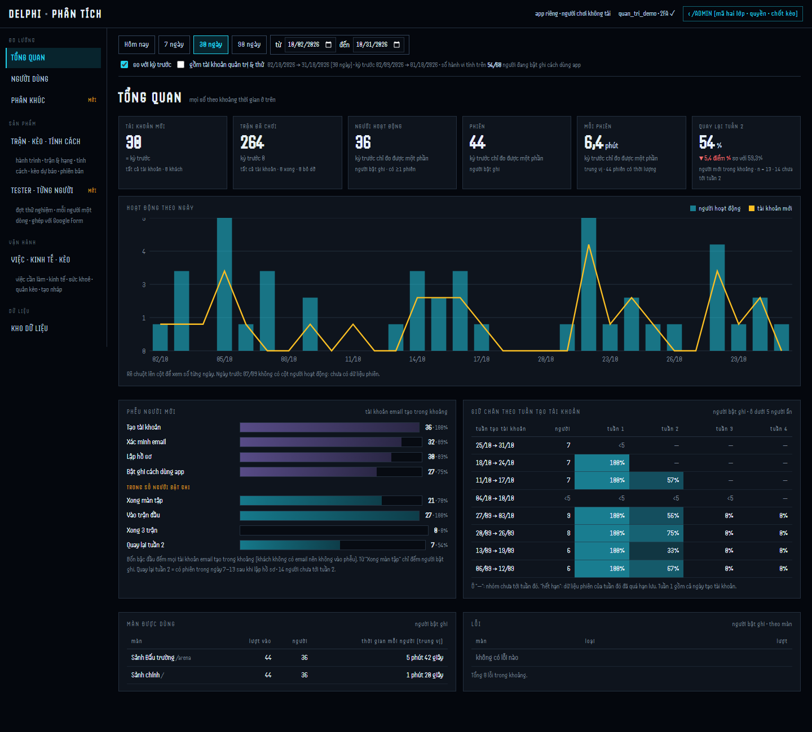

# Metrics dictionary

The product metrics the admin dashboard reports, defined precisely enough to recompute: what is counted, who is left out, when a number is unknown rather than zero, and when it is not shown at all. Each metric points to the query that runs in the product and to a standalone SQL file in [`analyses/sql/`](../analyses/sql/) that you can read top to bottom and run.

**There are no production numbers on this page, on purpose.** Every account in production belongs to the author (n real users = 0, see [ADR-004](adr/ADR-004-a-mapping-the-schema-does-not-state-is-a-hypothesis.md)), so a production funnel would describe one person testing the app. The queries are shown running on a [synthetic cohort](../analyses/README.md) instead; its output is in [`analyses/results/summary.md`](../analyses/results/summary.md).

## Where each metric is shown

The metrics are read every day on a separate admin page, `web/quan-tri.html` (code in `web/src/quan-tri/`). Its analytics routes are `/api/v1/admin/pt/*` in `server/admin_phan_tich.ts` (from line 787), behind `requireAuth`, `requireOnboarded` and `requireAdmin`, and admin routes also need a fresh two-factor check. The screenshot below runs locally on a synthetic cohort, not on production.

| metric | shown on (screen) | API route | product query | standalone SQL |
|---|---|---|---|---|
| New accounts, matches, active people, sessions, median session length | `web/src/quan-tri/TongQuan.tsx` — overview cards | `GET /api/v1/admin/pt/tong-quan` | `oSo` | — |
| New accounts and active people per day | `TongQuan.tsx` — daily chart | `GET /api/v1/admin/pt/tong-quan` | `chuoiNgay` | — |
| [New-account funnel](#new-account-funnel) | `TongQuan.tsx` — funnel | `GET /api/v1/admin/pt/tong-quan` | `pheuNguoiMoi` | [`04_funnel.sql`](../analyses/sql/04_funnel.sql) |
| [Week-2 return](#week-2-return), headline | `TongQuan.tsx` — overview card and last funnel row | `GET /api/v1/admin/pt/tong-quan` | `quayLaiCua` | [`05_week2_return.sql`](../analyses/sql/05_week2_return.sql) (`all`) |
| Retention by signup week (weeks 1–4) | `TongQuan.tsx` — retention table | `GET /api/v1/admin/pt/tong-quan` | `giuChan`, `gomGiuChan` | `05_week2_return.sql` (`signup_week`, week 2 only) |
| Time spent per screen | `TongQuan.tsx` — screens table | `GET /api/v1/admin/pt/tong-quan` | `manDung` | — |
| One person's sessions and events | `web/src/quan-tri/NguoiDung.tsx` | `GET /api/v1/admin/pt/nguoi`, `GET /api/v1/admin/pt/nguoi/:handle` | — | — |
| Segment metrics, including week-2 return per segment; split by age band, region, occupation, matches played, signup week | `web/src/quan-tri/PhanKhuc.tsx` | `GET`/`POST /api/v1/admin/pt/phan-khuc`, `POST /api/v1/admin/pt/phan-khuc/tinh`, `POST /api/v1/admin/pt/phan-khuc/chia`, `POST /api/v1/admin/pt/phan-khuc/:id/xoa` | `chiSoNhom`, `gomChia` | `05_week2_return.sql` (`age_band`) |
| [Small-group hiding](#rules-shared-by-every-metric) | `TongQuan.tsx`, `PhanKhuc.tsx` — a hidden value shows as `<5` | the routes above return `san: 5` and `NULL` values | `SAN` | `05_week2_return.sql` |
| [Thin-sample flag](#rules-shared-by-every-metric) | `web/src/quan-tri/KhuGom.tsx` (product area) → `web/src/screens/admin/MatSanPham.tsx` — marked "⚠ MẪU MỎNG" (thin sample, fewer than 10 finished matches) | `GET /api/v1/admin/tk/tran`, `GET /api/v1/admin/tk/phien-ban` (`server/admin_san_pham.ts`) | `SAN_TRAN_TIN_CAY` | — |

The fifth screen, `web/src/quan-tri/Tester.tsx`, manages test-account batches and shows no product metric.

## Rules shared by every metric

| rule | what it means | where it is enforced |
|---|---|---|
| Vietnam calendar days | "a day" is a day in `Asia/Ho_Chi_Minh`. Timestamps are stored in UTC and converted only at the edge of a window: `ts >= day 00:00 VN AND ts < (last day + 1) 00:00 VN`. Comparing UTC dates would shift every day by 7 hours | `config/telemetry.ts:556`, `dauNgay` / `ngayCua` in `server/admin_phan_tich.ts` |
| Who is counted | admin and test accounts are excluded by default ([ADR-003](adr/ADR-003-exclude-the-testers-from-the-analytics.md)). The filter is written `user_id IS NULL OR user_id NOT IN (…)` because `NULL NOT IN (…)` is not true and would drop accounts with no profile | `loaiAdmin`, `loaiTester` in `server/admin_thongke.ts:50`, `:81` |
| Which matches are counted | matches played with forced parameters, and matches on the fixed practice table, are not real play | `loaiTranCheat`, `loaiTranTap` in `server/admin_thongke.ts:111`, `:153` |
| Consent | behavioural numbers count only people whose research consent is on **when the number is read**, so someone who turns it off later disappears from the numbers too | `nguoi.research_consent` in every behavioural query |
| Raw telemetry lasts 90 days | raw rows expire after 90 days (`GIU_THO_NGAY`, `config/telemetry.ts:538`). A step that needs raw rows from before the first complete day is `NULL`, not 0 | `thoTu` in `server/admin_phan_tich.ts` |
| Unknown is `NULL` | a zero means "measured, found none". Not measured, not yet measurable and hidden are all `NULL`, and the output says which | [measurement-design.md](measurement-design.md#what-a-number-is-allowed-to-claim) |

Two rules about small numbers do different jobs and are easy to mix up:

| rule | applies to | threshold | what happens | why |
|---|---|---|---|---|
| **Small-group hiding** | a group of **people** (segment, signup cohort, retention cell) | fewer than **5** people — `SAN`, `server/admin_phan_tich.ts:49` | the numbers are not shown (`NULL`); an empty group still shows 0 | a count of 1–4 people points at individuals |
| **Thin-sample flag** | a sample of **matches** | fewer than **10** finished matches — `SAN_TRAN_TIN_CAY`, `config/giai_doan.ts:134` | the number is shown with a "thin sample" marker | hiding it would blind the author; trusting it would turn noise into a finding |

Small-group hiding is applied at `server/admin_phan_tich.ts:399`, `:405` (retention table), `:705` (one segment), `:759`, `:764` (segment split) and `:1109` (split totals). The thin-sample flag is set at `server/admin_san_pham.ts:472` and `:676`; its value matches the behaviour layer's "full pack" of 10 finished matches (`server/hanh_vi/goi.ts`), so both places give one answer to "is there enough to say anything yet?".

## New-account funnel

**Question:** of the accounts created in a window, how many reached each step of getting started?

- **Unit:** an e-mail account (`auth_accounts`). It is the one key that joins every step, including accounts that never created a profile.
- **Window:** the last 30 days up to today (the dashboard default, `KHOANG_MAC_DINH_NGAY`, `server/admin_phan_tich.ts:53`).
- **Product query:** `pheuNguoiMoi`, `server/admin_phan_tich.ts:327`. **Standalone:** [`analyses/sql/04_funnel.sql`](../analyses/sql/04_funnel.sql).

| # | step | counted when | share of |
|---|---|---|---|
| 1 | account created | an `auth_accounts` row was created in the window, plus abandoned guest accounts that a clean-up job deleted (counted per day in `khach_da_don_ngay`), so a clean-up never changes how many people signed up | — |
| 2 | e-mail verified | `email_verified_at IS NOT NULL` | step 1 |
| 3 | profile created | the account has a `user_id` (plus the same deleted guests as step 1) | step 1 |
| 4 | research consent on | `users.research_consent` is true now | step 1 |
| 5 | tutorial finished | a telemetry row `huong_dan_buoc` with `buoc = het`. `NULL` if the window starts before raw telemetry is complete | step 4 |
| 6 | entered a match | owns at least one real match (rules above) | step 4 |
| 7 | finished 3 matches | at least 3 result rows in real matches | step 4 |

**Read it with care:** steps 5–7 are each a subset of step 4, **not** of the step before them. A player can enter a match without finishing the tutorial, so "tutorial → match" is not a conversion rate and the funnel is not strictly narrowing.

## Week-2 return

**Question:** of the people who signed up, how many came back in their second week?

- **Unit:** a person with research consent on. Without consent there is no telemetry, so "did not come back" could not be told apart from "was not recorded".
- **Returned:** at least one `phien_mo` (app opened) telemetry row on days `[signup + 7, signup + 13]`, counted from that person's own signup day, not a calendar week.
- **Measurable:** the person's week 2 is over (`signup + 13 ≤ today`) **and** still inside the 90 days of raw telemetry (`signup + 7 ≥ first complete day`).
- **Rate:** returned ÷ measurable. People whose week 2 has not ended are reported as "not over yet", never as "did not return".
- **Product queries:** `quayLaiCua` (`server/admin_phan_tich.ts:262`) for the headline number, `gomGiuChan` (`:384`) for the retention table of 8 signup blocks × weeks 1–4, `gomChia` (`:734`) for splits by age band, region, occupation and matches played. **Standalone:** [`analyses/sql/05_week2_return.sql`](../analyses/sql/05_week2_return.sql) gives the headline, the 8 signup blocks and the age-band split in one result.

Every group in the output has one status:

| status | numbers shown | meaning |
|---|---|---|
| measured | yes | at least 5 people, at least 5 of them measurable |
| hidden: under 5 people | no | 1–4 people in the group |
| hidden: under 5 measurable | no | enough people, but fewer than 5 whose week 2 can be judged |
| week 2 not over yet | no | nobody's week 2 has ended |
| raw telemetry expired | no | everybody's week 2 is older than the raw data |
| empty | `n_signed_up = 0` | nobody in the group |

## Play-style score: small-sample discount

Not a dashboard metric but a number every player sees, and the clearest example of the small-sample rule inside the product. The score is a weighted mean of per-round scores in [0, 1]; `k = max(0, K0 − n)` pseudo-rounds at the neutral value 0.5 are added, with K0 = 4, so after round 4 the discount is gone (`server/holdem/phong_cach.ts:298`, constants at `:121` and `:123`). Why 4, and how it was measured on 600 matches: [ADR-005](adr/ADR-005-a-rating-ladder-must-be-climbable.md).

The estimator in [`analyses/analyze.py`](../analyses/analyze.py) is related but different: a fixed pseudo-count pulling towards the cohort mean, checked against a known truth on synthetic players.

## Not measured yet

Anything about real users. The first real measurement is planned for the next game build; until then the honest number of real users is 0, and this page will not quote a rate.
