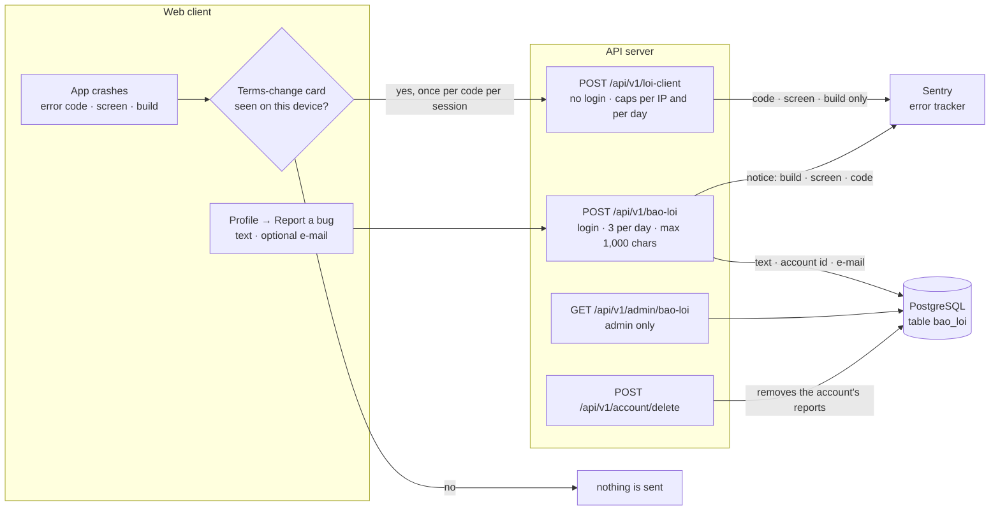

# Traceability: one feature from requirement to test

One complete feature traced end to end: every acceptance criterion in its spec, the test that checks it, and the fault that was injected to prove the test can fail. The feature is **player bug reports**: a "Report a bug" box in the profile screen, plus anonymous crash reports sent to an error tracker.

- **Spec:** [`docs/spec/bao-loi-nguoi-choi.md`](spec/bao-loi-nguoi-choi.md) (Vietnamese; an English summary opens the file). The criteria below are section 5 of that spec, translated.
- **Why this feature:** it touches every layer (client, API, database, a third-party service, the terms of service) and has a privacy promise that must hold in code. The terms text was approved word for word, and tests compare the app's text against the spec.

## How data moves

Two design choices carry the privacy promise:

1. **Crash reports go through the API, not a browser SDK.** Sentry never sees the player's IP address, the Sentry key never reaches the browser, and one place enforces the monthly quota. The payload is a hashed error code, a route *pattern* (no ids) and the build number — nothing that identifies a person, so it runs for everyone, guests included, with no switch to turn it off.
2. **What the player types stays in our database.** Sentry only receives a notice "new bug report" with build, screen and error code, so the text, the account id and the e-mail never leave the app's own database, and deleting the account deletes them.

Code: `server/loi_client_an_danh.ts:52` (crash reports) · `server/du_lieu_cua_toi.ts:139`, `:196` (bug box, admin list) · `server/app.ts:2317` (deletion) · `server/bao_loi.ts` (the Sentry adapter, so changing provider changes one file) · `config/bao_loi.ts` (limits) · migrations `0079` (table) and `0080` (e-mail column).

## Requirements → tests

Test files: `tests/bao_loi_nguoi_choi.test.ts` (server and database, embedded PostgreSQL, a fake Sentry SDK injected into the adapter) · `tests/du_lieu_cua_toi.test.ts` (account deletion) · `web/tests/bao_loi_an_danh.test.tsx` and `web/tests/bao_loi_bang.test.tsx` (client) · `tests/luong/trinh-duyet/bao_loi.mjs` (browser flow).

### Anonymous crash reports — `POST /api/v1/loi-client`

| id | requirement | test | fault injected → caught |
|---|---|---|---|
| R1 | Works for guests, players with research consent on, and players with it off; the payload carries exactly three labels: code, screen, build | `tests/bao_loi_nguoi_choi.test.ts:74` | |
| R2 | The payload reaching Sentry contains no user id, handle, cookie, IP or e-mail — every key and value is scanned | `tests/bao_loi_nguoi_choi.test.ts:94` | **(a)** add `user_id` to the payload on the server → 2 red |
| R3 | A code, screen or build of the wrong shape (a raw error message, an e-mail, a concrete URL instead of a route pattern…), or a body that is not JSON, is dropped silently: `202`, no call to Sentry | `tests/bao_loi_nguoi_choi.test.ts:112` (six cases), `:125` | |
| R4 | Per-IP daily cap: over the cap → `202` but no call (the client must not retry for ever) | `tests/bao_loi_nguoi_choi.test.ts:131` | |
| R5 | Global daily cap (50, `config/bao_loi.ts`) | `tests/bao_loi_nguoi_choi.test.ts:142` | remove the global cap → 1 red |
| R6 | No Sentry key configured → `202`, the channel stays silent, no counter row written | `tests/bao_loi_nguoi_choi.test.ts:150` | |
| R7 | The route writes nothing to the behavioural tables: no `telemetry`, no `events` row | `tests/bao_loi_nguoi_choi.test.ts:159` | |

### The bug-report box — `POST /api/v1/bao-loi`

| id | requirement | test | fault injected → caught |
|---|---|---|---|
| R8 | Login required: no cookie → `401`, nothing written, no call | `tests/bao_loi_nguoi_choi.test.ts:184` | |
| R9 | Stored in its own table `bao_loi` (not `events`), with the e-mail; the Sentry notice carries only build, screen and code — no text, no account id, no e-mail | `tests/bao_loi_nguoi_choi.test.ts:190` | **(d)** typed text into the notice → red · account id into the notice → red |
| R10 | Malformed e-mail → the field is dropped (`NULL`) and the report is kept, no `4xx` | `tests/bao_loi_nguoi_choi.test.ts:211` | drop the e-mail from the `INSERT` → red |
| R11 | Over 1,000 characters → `400`, nothing written, no call | `tests/bao_loi_nguoi_choi.test.ts:222` | |
| R12 | 3 reports per day per account; the 4th → `429`, nothing written, no call | `tests/bao_loi_nguoi_choi.test.ts:230` | **(c)** remove the daily limit → red |
| R13 | The admin can read text, account id and e-mail; anyone else → `403` | `tests/bao_loi_nguoi_choi.test.ts:240` | |
| R14 | Deleting the account deletes its reports; `events` rows stay (the log is append-only); no table still holds the e-mail or handle | `tests/du_lieu_cua_toi.test.ts:126` (the `bao_loi` check is at `:144`) | **(e)** skip the delete of `bao_loi` → red |

### Client — terms, gate and box

| id | requirement | test | fault injected → caught |
|---|---|---|---|
| R15 | **Order gate:** no crash report leaves a device whose user has not seen the terms-change card; after the card, one call per code per session | `web/tests/bao_loi_an_danh.test.tsx:47`, `:53`, `:80` | **(b)** remove the gate → 2 red |
| R16 | The request carries exactly the declared fields and no cookie | `web/tests/bao_loi_an_danh.test.tsx:63` | **(a)** add `user_id` to the payload on the client → 1 red |
| R17 | **Text ↔ behaviour:** every field sent is named in the terms, no named item is missing, and the terms give the right count in the right order | `web/tests/bao_loi_an_danh.test.tsx:109`, `:113`, `:126` | add a field without changing the terms → 4 red |
| R18 | The card shows once per device; both of its buttons count as seen | `web/tests/bao_loi_an_danh.test.tsx:147`, `:159` | |
| R19 | The app's text equals the approved text T1–T10 word for word (the test reads the spec file) | `web/tests/bao_loi_bang.test.tsx:31`–`:48` | change one word of T5 → red |
| R20 | The "sent with" line under the box and the request are built from one constant, field by field | `web/tests/bao_loi_bang.test.tsx:84` | build the line by hand → red |
| R21 | "Screen" is the screen the player was on before opening the profile, as a route pattern | `web/tests/bao_loi_bang.test.tsx:77` | use the current screen → red |
| R22 | No e-mail typed → no e-mail field in the request | `web/tests/bao_loi_bang.test.tsx:111` | |
| R23 | The 4th send shows the "limit reached" text and keeps what the player typed | `web/tests/bao_loi_bang.test.tsx:120` | clear the text on `429` → red |

### End to end

| id | requirement | check |
|---|---|---|
| R24 | In a real browser against the real server: terms card → Profile → Report a bug → "Sent." → the 4th send hits the limit, the box keeps its text, the server holds exactly 3 reports | `node tests/luong/trinh-duyet/bao_loi.mjs` — 10 of 10 steps passed on 12 Oct 2026 |

## Fault injection, in short

Each fault was injected by `scripts/tiem.ts`, which edits the source, runs the tests, and restores the files byte for byte ([ADR-011](adr/ADR-011-acceptance-means-breaking-the-code-on-purpose.md)). Faults (a)–(e) were planned in the spec before the code was written; the others were added during the build. **All 15 faults injected into this feature turned at least one test red.** The red counts above come from the build record of 11–12 Oct 2026 (private decision log, entry D600); they were not re-run for this page.

## Not covered by a test

- Whether Sentry e-mails the author about each notice is a setting in the Sentry account, outside the code. The spec leaves it, and one real report on production, to a manual check after deployment.
- The privacy of the stored text rests on the database: the tests prove what the API writes and deletes, not who else can read the table. Row-level security on every table is checked separately ([`docs/api/erd.md`](api/erd.md)).
